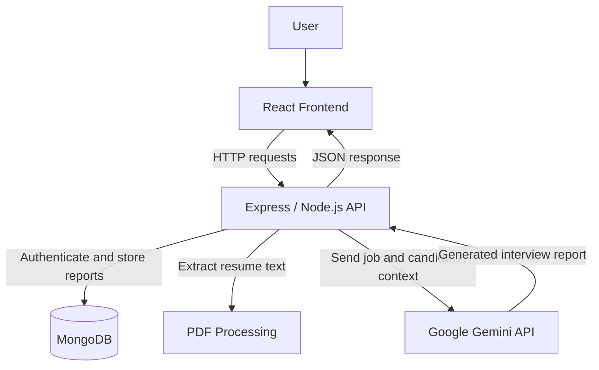

<div align="center">

# 🎯 Interview AI

### AI-Powered Interview Preparation & Job-Readiness Analysis

**Turn a job description and your professional background into a focused interview preparation strategy.**

[](https://react.dev/)
[](https://nodejs.org/)
[](https://expressjs.com/)
[](https://www.mongodb.com/)
[](https://ai.google.dev/)

[Features](#-features) · [Architecture](#-architecture) · [Getting Started](#-getting-started) · [Project Structure](#-project-structure)

</div>

---

## 📌 Overview

**Interview AI** is a full-stack web application designed to help job seekers prepare more effectively for technical interviews. It combines a target job description with information about the candidate—such as an uploaded PDF resume or a written self-description—and uses Google's Gemini API to generate a personalized interview preparation report.

Rather than relying on generic interview question lists, the application focuses on the requirements of a specific role and the candidate's background.

## ✨ Features

- **Job-description analysis** — Provide the responsibilities and required skills for a target position.
- **Candidate profile input** — Upload a PDF resume and/or describe your experience and skills.
- **AI-generated interview strategy** — Generate a tailored preparation report using the Gemini API.
- **Skill-gap insights** — Identify areas to focus on based on the target role.
- **Interview question suggestions** — Prepare for questions relevant to the job and candidate profile.
- **Preparation guidance** — Receive structured recommendations for interview readiness.
- **User authentication** — Sign in to access user-specific functionality.
- **Report persistence** — Store interview report data in MongoDB for authenticated users.

> **Note:** AI-generated suggestions are intended as preparation aids, not guarantees of interview performance or hiring outcomes.

## 🛠️ Tech Stack

| Layer | Technologies | Purpose |
| --- | --- | --- |
| Frontend | React, JavaScript | Interactive user interface |
| Backend | Node.js, Express.js | REST API and application logic |
| Database | MongoDB, Mongoose | User and report persistence |
| Authentication | JWT, HttpOnly cookies | Session authentication |
| AI integration | Google Gemini API (`@google/genai`) | Personalized content generation |
| File processing | Multer, PDF parsing | Resume upload and text extraction |
| Version control | Git, GitHub | Source management |

## 🏗️ Architecture



### Typical request flow

1. The user signs in and opens the interview strategy form.
2. The user provides a target job description and candidate information.
3. The backend validates the request and extracts text from an uploaded PDF, when provided.
4. The backend sends the relevant context to Gemini.
5. Gemini generates a tailored interview preparation report.
6. The backend returns the result to the frontend and handles report persistence.

## 📁 Project Structure

```text
interview-ai-final/
├── Backend/
│   ├── src/
│   │   ├── controllers/       # Request handlers
│   │   ├── middlewares/       # Authentication and file handling
│   │   ├── models/            # Mongoose models
│   │   ├── routes/            # API endpoints
│   │   └── services/          # AI integration and business logic
│   ├── server.js
│   └── package.json
├── Frontend/
│   ├── src/                   # React application
│   └── package.json
├── .gitignore
└── README.md
```

## 🚀 Getting Started

### Prerequisites

- Node.js and npm
- A MongoDB database (local or MongoDB Atlas)
- A Google Gemini API key

### 1. Clone the repository

```bash
git clone https://github.com/Rajeev21862/interview-ai-final.git
cd interview-ai-final
```

### 2. Install backend dependencies

```bash
cd Backend
npm install
```

Create a `Backend/.env` file with the configuration expected by your backend. For example, you will need values for:

- MongoDB connection URI
- JWT signing secret
- Gemini API key
- Backend port and any required frontend/CORS origin configuration

**Important:** Check the exact environment variable names used in your source code before configuring `.env`; the names above describe the required values, not verified variable identifiers. Never commit `.env` or API secrets.

Start the backend:

```bash
npm run dev
```

### 3. Install and run the frontend

In a **second terminal**, from the repository root:

```bash
cd Frontend
npm install
npm run dev
```

Open the local URL printed by the frontend development server (typically `http://localhost:5173`). Ensure the frontend's API URL and backend CORS configuration match your local setup.

## 🔐 Authentication & Security

The application uses JWT-based authentication with HttpOnly cookies. Authenticated backend routes can verify the token before accessing user-specific resources.

Security practices to retain and strengthen include:

- Keep API keys, database credentials, and JWT secrets in environment variables.
- Validate user input and uploaded files on the server.
- Configure CORS and cookie attributes for the actual deployment environment.
- Enforce authorization for user-owned reports.
- Handle external API failures without exposing sensitive error details.

## 🧠 Engineering Considerations

**Database access:** Filtering reports by authenticated user, sorting by creation date, and limiting or paginating results can keep report-history requests manageable as data grows. A compound index on user and creation time may improve this query pattern.

**External AI reliability:** Gemini API requests can fail because of rate limits, model availability, or transient service errors. Production-grade handling should distinguish retryable errors (such as some `503` responses) from configuration or model-access errors (such as `404`).

**Privacy:** Resumes and self-descriptions can contain personal information. Handle uploads, storage, logging, and third-party AI requests with appropriate privacy controls.

## 🗺️ Potential Improvements

- [ ] Add bounded retries with exponential backoff for temporary AI API failures.
- [ ] Add paginated or cursor-based report history.
- [ ] Add automated backend and frontend tests.
- [ ] Improve error messages and loading states.
- [ ] Add deployment configuration and CI checks.

## 📷 Screenshots

_Add screenshots of the login screen, interview strategy form, and generated report here once they are ready._

## 👤 Author

**Rajeev**  
GitHub: [@Rajeev21862](https://github.com/Rajeev21862)

---

<div align="center">

**Built to make interview preparation more targeted, structured, and actionable.**

</div>
